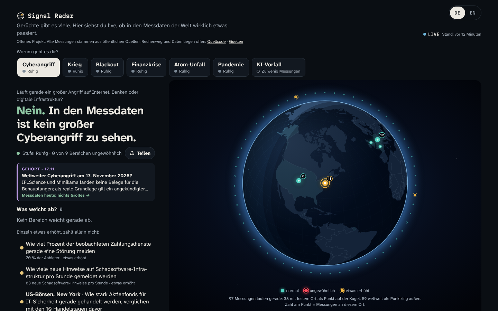

# Signal Radar

Signal Radar ist ein offenes Anomalie-Radar: Es liest öffentliche, passive Messdaten (Netzwerke, Stromnetze, Märkte, Meldungen) und zeigt je Thema, ob die Messwerte gerade ungewöhnlich sind, und zwar in wie vielen voneinander unabhängigen Bereichen gleichzeitig. Es ist ein Messinstrument, keine Vorhersage.

Live-Seite: https://signal-radar.safak-t.workers.dev/



English summary at the end of this file.

## Was man auf der Seite sieht

- **Antwort je Thema.** Sieben Themen (Cyberangriff, Kriegseskalation, Blackout und Energiekrise, KI-Vorfall, Finanzkrise und Bankenstress, nuklearer Zwischenfall, Pandemie und Ausbrüche), jeweils mit einer Stufe von 0 (Ruhig) bis 4 (Akut) und der Begründung bis zur einzelnen Messung.
- **Globus mit Messpunkten.** Jede Messung mit bekanntem Ort liegt auf dem Globus. Ruhige Punkte sind grau, ungewöhnliche leuchten. Dazu kommen ungewertete Kartenschichten (Erdbeben, Naturereignisse, Katastrophenmeldungen), die nie in die Stufe einfließen.
- **Gerüchte-Abgleich.** Zu kursierenden Behauptungen steht neben der Aufmerksamkeit im Netz, was die Messdaten dazu zeigen. Aufmerksamkeit (Suchtrends, Seitenaufrufe, Foren) wird getrennt von der Messung geführt, die Lücke zwischen beiden wird benannt.
- **Rückblick auf echte Ereignisse.** Das Radar wird über vergangene Ereignisse (zum Beispiel Facebook-Ausfall 2021, Stromausfall auf der Iberischen Halbinsel 2025) und über ruhige Vergleichszeiträume abgespielt, mit dem Stand, den es damals gezeigt hätte. Auch die Fehlschläge stehen dort (siehe Ehrliche Grenzen).

## Grundsätze

- **Nur öffentliche, passive Messdaten.** Kein Scannen, Proben oder Testen fremder Systeme, keine Umgehung von Logins oder Bezahlschranken.
- **Keine Personen.** Nur Aggregate und Daten zu Infrastruktur, Märkten und Netzen, keine Profile, keine einzelnen Konten.
- **Misstrauen in beide Richtungen.** Offizielle Aussagen und Presse sind kein Beleg: Sie erscheinen als Kontext und werden nie gewertet. Die eigenen Muster sind es auch nicht. Jede Abweichung wird deshalb mit der eigenen Vergangenheit der Messung verglichen, auf harmlose Ursachen geprüft (zum Beispiel Patch-Dienstag, Monatswechsel) und zählt für höhere Stufen nur, wenn mehrere unabhängige Bereiche zugleich abweichen.

## Wie bewertet wird

Eine Messung gilt als ungewöhnlich, wenn sie weiter von ihrem Normalwert entfernt ist, als diese Messreihe es sonst fast immer tut; der Normalwert kommt nur aus der eigenen Vergangenheit der Messung. Bei Messreihen mit genug Vergangenheit war das im Mittel 1,8 % der Zeit der Fall (etwa 1 von 55 Zeitpunkten); neue Reihen mit kurzer Vergangenheit schlagen öfter aus (4,8 %), zählen deshalb erst ab sieben früheren Werten und danach zunächst nur halb. Ein Bereich (zum Beispiel Zahlungsverkehr oder Stromnetz) gilt als ungewöhnlich, wenn mindestens eine seiner Quellen deutlich ausschlägt; mehrere Kennzahlen derselben Quelle zählen einmal, und in den letzten 30 Tagen war ein Bereich im Mittel 0,2 % der Zeit ungewöhnlich (etwa 1 von 588 Stunden). Ein einzelner ungewöhnlicher Bereich hebt ein Thema höchstens auf Stufe 1, für jede höhere Stufe müssen mehr unabhängige Bereiche gleichzeitig abweichen. In den letzten 30 Tagen war ein Thema im Mittel 0,3 % der Zeit auf Stufe 1 oder höher, Stufe 2, 3 und 4 kamen bei keinem Thema vor. Die Zahlen stammen aus der Messung an den Live-Daten vom 24.11.2026 (Basis: 30 Tage, 184 Signale, 8824 Vergleichspunkte; `frontend/data/explain.json`, [docs/CALIBRATION.md](docs/CALIBRATION.md)); das Modell im Einzelnen steht in [docs/SCORING.md](docs/SCORING.md).

## Ehrliche Grenzen

Zahlen aus [backtest/REPORT.md](backtest/REPORT.md) und `frontend/data/replays/index.json`.

- **Elf historische Ereignisse wurden wiedergegeben.** Gesehen (Stufenanstieg durch abweichende Bereiche): 3 (Stromausfall Iberische Halbinsel 2025, Krieg Israel und Iran 2025, Rogers-Ausfall Kanada 2022). Teilweise: 2 (Facebook-Ausfall 2021, CrowdStrike 2024). Nicht gesehen: 6 (Change Healthcare, Colonial Pipeline, Dyn, Log4Shell, MOVEit, NotPetya).
- **Verzögerung.** Das Radar bestätigt Ereignisse nach Stunden. Iberischer Stromausfall und Rogers: Stufe 1 beim ersten Rechenschritt nach Beginn, also nach ein bis zwei Stunden (gerechnet wird im Rücktest alle 3 Stunden). Israel und Iran: Stufe 1 nach 51 Stunden, Stufe 2 nach 135 Stunden. Facebook: Stufe 1 zum Beginn, aber nur durch eine einzige Messung, die auch vorher schon ausschlug, daher nur „teilweise“.
- **In keinem Fall gab es eine Vorwarnung.** Ausschläge vor Beginn waren Rauschen oder nicht belegt (CrowdStrike: nur der VIX, ohne belegten Bezug zum Ausfall).
- **Höchste Stufe war 2**, erreicht nur beim Krieg zwischen Israel und Iran. Die Stufen 3 und 4 sind in der Praxis noch nicht beobachtet.
- **Firmen-Vorfälle sind mit offenen Daten nicht sichtbar.** Change Healthcare, Colonial Pipeline, Log4Shell und MOVEit zeigten in den verfügbaren Messungen nichts.
- **Vier ruhige Vergleichszeiträume** (August 2019, August 2023, Spanien und Portugal, Nahost) blieben alle auf Stufe 0. Das ist eine kleine Stichprobe.
- **Kurze Datenbasis.** Die Kalibrierung beruht auf 30 Tagen. Stufe 2 kam in dieser Zeit nie vor, die Stufen 2 bis 4 lassen sich damit nicht feiner abstimmen.
- **Dünne Themen.** Im Live-Snapshot vom 24.11.2026 hatten Pandemie 23, KI-Vorfall 14 und Blackout 15 Messungen mit aktuellem Wert. Pandemie hat nur in 3 von 8 Bereichen Daten, KI in 4 von 6, Nuklear in 4 von 6, Krieg in 5 von 7. Dem Thema KI ist bisher erst 1 von 11 Messungen ein Ort zugeordnet.
- **Takt.** Der Zeitplan alle 15 Minuten wurde von GitHub zuletzt nur alle 6 bis 12 Stunden ausgeführt (Ursache ungeprüft, siehe [PROGRESS.md](PROGRESS.md)).
- Die Stufe ist keine Wahrscheinlichkeit und kein Beleg für Absicht oder Urheber. „Erhöht“ kann auch ein Ausfall oder eine Wartung der Quelle sein.

## Bestand

Gezählt am 24.11.2026 per Befehl im Repo:

- 7 Themen (`catalog/scenarios.json`).
- 91 Collectors (`ls src/collectors/*.ts | grep -v "/_" | wc -l`), davon laut `docs/STATUS.md` 66 gegen eine echte Antwort geprüft, 5 teilweise, 20 nicht.
- 877 Signale im Katalog, davon 298 mit Collector (`python3 -I scripts/status_report.py`, Ergebnis in [docs/STATUS.md](docs/STATUS.md)).
- 237 Messungen mit aktuellem Wert im Live-Snapshot (`frontend/data/snapshot.json`, Stand 24.11.2026 01:55 UTC, Status `active` mit Wert).

## Selbst betreiben

Voraussetzung: Node.js ab 22.18. Es gibt keinen Build und keine Abhängigkeiten, `npm install` ist nicht nötig.

```
npm test                          # Tests
npm run replay                    # Collectors gegen aufgezeichnete Antworten (fixtures/) abspielen
npm run serve                     # Frontend lokal auf http://localhost:4173
npm run run                       # Live: Collectors abrufen und Snapshot bauen (braucht Internet)
npm run collect                   # nur sammeln
npm run snapshot                  # nur Snapshot aus gespeicherten Daten bauen
python3 -I scripts/status_report.py   # docs/STATUS.md neu erzeugen
```

Betrieb mit GitHub Actions: `.github/workflows/collect.yml` sammelt und bewertet nach Zeitplan alle 15 Minuten und legt die Daten als Commits ab, `deploy-cloudflare.yml` liefert `frontend/` aus, `backfill.yml` lädt historische Antworten für den Backtest. Einzelheiten in [docs/DEPLOY.md](docs/DEPLOY.md) (Teile davon beschreiben noch den früheren Netlify-Weg). Schlüssel sind optional: Collectors, die einen brauchen, werden ohne ihn übersprungen und nicht als Fehler gezählt. Liste und Bearbeitungsstand in [docs/KEYS-NEEDED.md](docs/KEYS-NEEDED.md).

## Mitmachen, Lizenz, Quellen

- **Mitmachen:** Neue Quellen, Signale und Themen sind willkommen. Die Regeln stehen in [CONTRIBUTING.md](CONTRIBUTING.md), die technische Anleitung im [Collector-Guide](docs/COLLECTOR-GUIDE.md), Schwächen der Methode gehören in [docs/OPEN-QUESTIONS.md](docs/OPEN-QUESTIONS.md).
- **Lizenz:** Das Repo enthält keine LICENSE-Datei, eine Projekt-Lizenz ist also noch nicht festgelegt; ohne Lizenz sind keine Nutzungsrechte eingeräumt. Die Schriften unter `frontend/assets/fonts/` stehen unter der SIL Open Font License 1.1. Die Lizenzen der Datenquellen sind teils ungeklärt ([docs/LICENSE-TODO.md](docs/LICENSE-TODO.md)).
- **Quellen-Nennung:** Pflichtangaben und geprüfte Nutzungsbedingungen der Datenquellen stehen in [docs/DATA-TERMS.md](docs/DATA-TERMS.md) und `src/core/attribution.ts`; die Seite zeigt sie im Fuß und an der jeweiligen Messreihe.

Weitere Dokumente: [Architektur](docs/ARCHITECTURE.md), [Plan V2](docs/PLAN-V2.md), [Fortschrittsprotokoll](PROGRESS.md).

## English summary

Signal Radar is an open anomaly radar. It reads public, passive measurement data and shows, per topic (cyber attack, war escalation, blackout, AI incident, financial stress, nuclear incident, outbreaks), how unusual current readings are and in how many independent areas at once, on a scale from 0 to 4. It is a measuring instrument, not a forecast. Live: https://signal-radar.safak-t.workers.dev/

Principles: only public passive data, no people, and distrust in both directions (official statements are context, never evidence; the radar's own patterns must pass comparison with their own history, harmless explanations and several independent areas). Measured over 30 days of live data, a single series with enough history was unusual 1.8 % of the time, an area 0.2 % of the time, and no topic reached level 2 or higher.

Honest limits: of 11 replayed historical events, 3 were seen, 2 partly, 6 not. Detection came hours after the start (1 h for the Iberian blackout and Rogers, 51 h for level 1 and 135 h for level 2 in the Israel and Iran war), never before. Company incidents (Change Healthcare, Colonial Pipeline, Log4Shell, MOVEit) are not visible in open data. Some topics are still thin.

Counts (24 Nov 2026): 7 topics, 91 collectors, 877 catalog signals (298 with a collector), 237 measurements with a current value. Requirements: Node.js 22.18 or newer, no dependencies (`npm test`, `npm run serve`, `npm run run`). Keys are optional. There is no LICENSE file yet, so no usage rights are granted. See docs/DATA-TERMS.md for source attribution and CONTRIBUTING.md to contribute.
