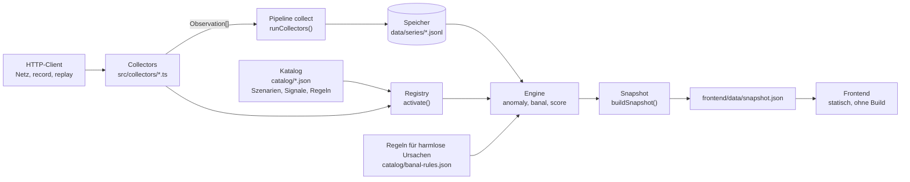

# Architektur

Signal Radar ist eine Kette aus fünf Schritten, die jeweils nur über einen kleinen Datenvertrag miteinander reden. Jeder Schritt lässt sich einzeln ersetzen und einzeln testen. Maßgeblich sind die Typen in `src/core/types.ts`.

## Datenfluss



1. **Katalog** (`catalog/`): Szenarien mit Bereichen und Gewichten (`scenarios.json`), Signal-Definitionen (`signals/<szenario>.json`), Regeln für harmlose Ursachen (`banal-rules.json`). Reine Daten. `loadCatalog()` prüft auf doppelte Signal-Ids.
2. **Collectors** (`src/collectors/<id>.ts`): holen Rohdaten **einer** Quelle und geben `Observation[]` zurück (`signalId`, `ts` in UTC, `value`). Keine Bewertung. Jeder Collector deklariert seine Signale; `activate()` in `src/core/registry.ts` legt diese Angaben über den Katalog-Eintrag gleicher Id (oder fügt neue Signale hinzu) und setzt den Status `active`, bzw. `needs-key`, wenn der Key fehlt.
3. **Speicher**: hängt Beobachtungen an, ignoriert bereits bekannte Zeitstempel. Standard sind JSONL-Dateien (siehe unten).
4. **Engine** (`src/engine/`): berechnet je Signal die Abweichung vom eigenen Normalwert, dämpft bekannte harmlose Ursachen, fasst pro Bereich und Szenario zusammen und deckelt die Stufe nach der Zahl abweichender Bereiche. Beschreibung: [SCORING.md](SCORING.md). Die Engine ist eine reine Funktion von (Katalog, Serien, Zeitpunkt).
5. **Snapshot** (`src/pipeline/snapshot.ts`): `buildSnapshot()` bewertet jedes Szenario für „jetzt“ und rechnet den Verlauf für vergangene Zeitpunkte aus denselben Rohdaten neu (Standard 14 Tage, alle 3 Stunden). Der Verlauf ist also nicht gespeichert, sondern reproduzierbar. Nur Signale mit Status `active` werden gelesen. Ergebnis ist die Datei `frontend/data/snapshot.json`.
6. **Frontend** (`frontend/`): lädt `data/snapshot.json` und zeichnet es. Es rechnet nichts nach.

Der Befehl `node src/cli.ts run` führt 2 bis 5 hintereinander aus, `collect` nur 2 und 3, `snapshot` nur 4 und 5.

## Datenverträge

Alle in `src/core/types.ts`:

| Vertrag | Zwischen | Inhalt |
|---|---|---|
| `Collector` | Registry und Collector | `id`, `title`, `sourceUrl`, optional `needsKey` (Name der Umgebungsvariable), `intervalMinutes`, `signals` (Teil-Definitionen), `collect(ctx)` |
| `CollectContext` | Pipeline und Collector | `now`, `http` (Client), `key(name)`, `log` |
| `CollectorResult` | Collector und Speicher | `observations: Observation[]`, optional `context: ContextItem[]` (Klasse C, nie gewertet) |
| `Observation` | Collector und Speicher | `signalId`, `ts` (ISO 8601 UTC), `value` (endliche Zahl), optional `meta` |
| `SignalDef` | Katalog und Engine | Bereich, Evidenzklasse (A bis D), Richtung, Art, Gewicht 0 bis 1, Manipulierbarkeit, Unabhängigkeitsgruppe, Baseline, Schwellen, Haltezeit, Intervall, Status, Quelle, Lizenz |
| `ScenarioDef` | Katalog und Engine | Titel, Frage, Bereiche mit Gewicht, Reihenfolge |
| `BanalRule` | Katalog und Engine | Muster auf Signal-Ids, Faktor 0 bis 1, Begründung, Parameter |
| `Snapshot` | Engine und Frontend | `schema: 1`, `generatedAt`, `mode` (`live`, `snapshot`, `demo`), `sensitivity`, optional `note`, `scenarios: ScenarioView[]` |
| `ScenarioView` | Snapshot | Stufe 0 bis 4, Wert, Aussage, Aufmerksamkeit, `rumorGap`, Vertrauen, Abdeckung, Bereiche mit Signalen (`SignalView`), Kontext, Verlauf |

Das Frontend prüft beim Laden `schema === 1` und die Grundform des Snapshots und zeigt sonst einen Fehlerzustand. Eine inkompatible Änderung am Snapshot braucht daher eine neue `schema`-Nummer.

## Warum kein Build und keine Abhängigkeiten

- **Läuft überall.** Node ab 22.18 entfernt TypeScript-Typen selbst (natives Type-Stripping), `fetch` und `node:test` sind eingebaut. `npm install` ist nicht nötig; der GitHub-Workflow braucht nur `setup-node`.
- **Prüfbar.** Wer das Projekt prüft oder forkt, liest genau den Code, der läuft. Es gibt keine übersetzte Ausgabe und keinen Lockfile-Baum, den man mitprüfen müsste.
- **Weniger Angriffsfläche.** Ohne Fremdpakete gibt es keine Lieferketten-Risiken im Sammler. Das Frontend lädt nichts von Dritten (Schriften lokal, CSP ohne Fremd-Quellen), die Besucher-IP geht an niemanden außer den Auslieferer.
- **Folge:** Code in `src/` nutzt nur Syntax, die Type-Stripping versteht, und Importe enden auf `.ts`. Ein Collector darf keine npm-Pakete einbinden.

## Speicher-Schnittstelle

```ts
interface Store {
  read(signalId: string): Promise<Observation[]>;
  append(observations: Observation[]): Promise<number>;   // Zahl neu gespeicherter Werte
  getJson<T>(key: string): Promise<T | null>;
  setJson(key: string, value: unknown): Promise<void>;
}
```

Der Standard `fileStore(dir)` (`src/core/store.ts`) legt eine Datei je Signal an: `data/series/<signalId>.jsonl`, eine Zeile `{"t": ISO, "v": Zahl, "m": {...}}` je Beobachtung. Ungültige Werte (`NaN`, kaputter Zeitstempel) werden verworfen, ein bekannter Zeitstempel wird nicht überschrieben, eine beschädigte Zeile bricht den Lauf nicht ab. `getJson`/`setJson` halten Zustand unter `data/state/` (`last-run`, `context`, `last-report`).

Dass es einfache Dateien sind, ist Absicht: Im GitHub-Betrieb wird jeder Lauf als Commit abgelegt, jeder Datenpunkt ist in der Git-Historie nachprüfbar, und jeder kann das Repo forken und die Bewertung auf denselben Rohdaten wiederholen. Ein anderes Backend (z. B. Netlify Blobs) implementiert dieselbe Schnittstelle; ein solches Backend ist im Repo nicht enthalten. Wachstum: ein Commit alle 15 Minuten vergrößert die Git-Historie dauerhaft.

Optional liest die CLI vor dem Sammeln `data-seed/<signalId>.jsonl` (Zeilen `{t, v}`) ein, etwa für eine aus einer Git-Historie rekonstruierte Reihe (`scripts/backfill_git_history.py`).

## Fixtures und Replay

Der HTTP-Client (`src/core/http.ts`) ist der einzige Weg ins Netz (`ctx.http.json/text`) und kennt drei Modi über `SR_FIXTURES`:

| Wert | Verhalten |
|---|---|
| nicht gesetzt | Netzabruf mit Timeout (20 s), User-Agent `SignalRadar/0.1 (...)`, einem Wiederholungsversuch und Mindestabstand je Host (1 s) |
| `record` | Netzabruf und Rohantwort unter `fixtures/<name>` speichern |
| `replay` | nur aus `fixtures/<name>` lesen, fehlende Datei ist ein Fehler |

Jeder Request hat einen stabilen Fixture-Namen (`<quelle>/<name>.json`). Daraus folgt:

- Jeder Parser lässt sich gegen eine **echte** Antwort testen, ohne Netz (`tests/collectors/<id>.test.ts`).
- `npm run replay` (`SR_FIXTURES=replay node src/cli.ts run --now-from-fixtures`) spielt alle Collectors gegen `fixtures/` ab. Als „jetzt“ dient `fixtures/META.json` (`capturedAt`). Daten gehen nach `data-replay/` (nicht versioniert), der Snapshot bekommt `mode: "snapshot"` und eine Notiz „Momentaufnahme aus aufgezeichneten echten Antworten. Kein Live-Betrieb.“
- Wo die Bau-Umgebung kein Netz hatte, wurden Antworten einzeln über ein Abruf-Werkzeug aufgezeichnet. Wünsche dafür stehen in `fixtures/queue/<collector>.json`, Protokolle in `fixtures/CAPTURE-LOG.jsonl` und `fixtures/CAPTURE-ERRORS.jsonl`. Einige große Dateien sind per `.gitignore` ausgeschlossen.
- Der Backtest (`src/backtest/`) nutzt dieselben Aufzeichnungen und rechnet für vergangene Zeitpunkte mit der unveränderten Engine.

## Erweiterungspunkte

| Was | Wo | Aufwand |
|---|---|---|
| Neue Quelle | `src/collectors/<id>.ts` (Default-Export `Collector`); wird von `discoverCollectors()` automatisch gefunden, Dateien mit `_` sind Helfer | eine Datei plus Test; siehe [COLLECTOR-GUIDE.md](COLLECTOR-GUIDE.md) |
| Neues Szenario | `catalog/scenarios.json` und `catalog/signals/<id>.json` | nur Daten |
| Neue harmlose Ursache | `catalog/banal-rules.json` (Typen `date-range`, `nth-weekday`, `weekday`, `day-of-month`, `signal-condition`) | nur Daten |
| Anderes Speicher-Backend | `Store` implementieren und in `src/cli.ts` statt `fileStore` einsetzen | klein, aber nicht vorhanden |
| Empfindlichkeit | `SR_SENSITIVITY=normal\|high` | Umgebungsvariable |
| Übersetzung des Frontends | Texte stehen in einer zentralen Tabelle in `frontend/app.js` | Frontend-Änderung |
| Kontext-Layer (Klasse C) | Collector gibt `context: ContextItem[]` zurück; landet unter `data/state/context.json` | im Collector |
| Anderer Betrieb | GitHub Actions oder Netlify, siehe [DEPLOY.md](DEPLOY.md) | Konfiguration |
